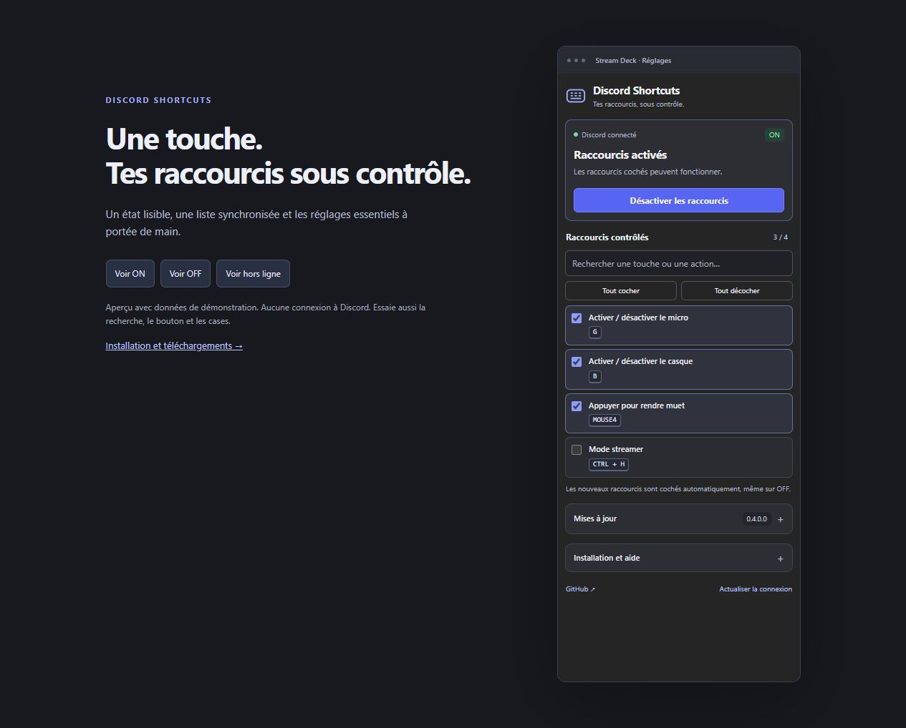

# Discord Shortcuts

**Un bouton Stream Deck pour suspendre tes raccourcis Discord.**

Garde tes touches pour écrire et jouer. Sur **OFF**, leurs actions Discord sont suspendues ; sur **ON**, elles fonctionnent à nouveau.

[**Télécharger l’assistant Windows**](https://github.com/Sheixo/DiscordShortcuts/releases/download/v0.4.0/DiscordShortcuts-Assistant-Windows-0.1.0.zip) · [**Installer, réparer ou désinstaller**](docs/INSTALLATION.fr.md) · [Signaler un problème](https://github.com/Sheixo/DiscordShortcuts/issues)

> **Deux composants sont nécessaires :** le plugin Stream Deck et le connecteur ShortcutToggle dans Vencord. Cette version ne fonctionne pas avec Discord non modifié.

## Installation rapide

1. Télécharge le ZIP de l’assistant et utilise **Extraire tout**.
2. Quitte complètement Discord et Stream Deck depuis leurs icônes près de l’horloge.
3. Ouvre **DiscordShortcuts-Assistant.exe**, garde ton dossier Vencord existant et choisis **Tout installer**.
4. Relance les applications, active **ShortcutToggle** dans les plugins Vencord et ajoute l’action **Discord Shortcuts** à une touche Stream Deck.

**Une seule fenêtre** propose **Tout installer**, **Stream Deck uniquement**, **Vérifier / Réparer** et **Tout désinstaller**. Le bouton **Vérifier seulement** contrôle les fichiers sans les modifier. Node.js 22 ou une version LTS plus récente, Git et pnpm restent nécessaires pour le connecteur ; le [guide](docs/INSTALLATION.fr.md) détaille les prérequis. Pour une mise à jour, réutilise **Tout installer** dans le nouveau paquet.

La désinstallation retire uniquement nos deux composants : Vencord, les autres plugins et les profils Stream Deck sont conservés, avec des sauvegardes des fichiers retirés.

Fichiers séparés pour les utilisateurs avancés : [connecteur Vencord](https://github.com/Sheixo/DiscordShortcuts/releases/latest/download/index.tsx) · [plugin Stream Deck](https://github.com/Sheixo/DiscordShortcuts/releases/latest/download/fr.ethan.discord-shortcuts.streamDeckPlugin) · [ancien assistant en console](https://github.com/Sheixo/DiscordShortcuts/releases/download/v0.4.0/DiscordShortcuts-Installation-Windows-0.4.0.zip) · [archive de la version initiale](https://github.com/Sheixo/DiscordShortcuts/releases/latest/download/DiscordShortcuts-0.4.0.zip).

Le [guide détaillé](docs/INSTALLATION.fr.md) explique l’installation et la mise à jour.

## Au quotidien

- **ON** autorise les actions des raccourcis cochés ; **OFF** les suspend.
- Les nouveaux raccourcis Discord sont ajoutés et cochés automatiquement, même sur OFF.
- Les ajouts, changements de touche ou d’action et suppressions se synchronisent. Tes choix de sélection sont conservés.
- La recherche et les boutons de sélection par lots facilitent le réglage.
- Le bouton affiche l’état confirmé par Discord. Une coupure de connexion affiche **Hors ligne** ; OFF est conservé lorsque le compagnon se reconnecte.
- Les touches gardent leurs autres usages. Les raccourcis déjà désactivés dans Discord restent désactivés.
- Les mises à jour peuvent être recherchées chaque jour ; leur installation reste manuelle.

Au redémarrage de Discord, le connecteur repart sur **ON**. Crée ou modifie tes raccourcis dans **Discord → Paramètres → Raccourcis clavier**.

## Compatibilité

Discord officiel **Stable** sous **Windows 10 ou plus récent**, Vencord construit depuis ses sources et **Stream Deck 7.1 ou plus récent**. Les raccourcis clavier, les combinaisons et les boutons souris personnalisés sont pris en charge. Vesktop, Discord PTB/Canary, le navigateur, macOS et Linux ne sont pas annoncés comme compatibles.

Le connecteur reste nommé **ShortcutToggle** dans Vencord. Toute la gestion est dans Stream Deck : aucun bouton Discord ni raccourci F13 supplémentaire n’est installé.

## Versions de cette publication

| Ensemble | Stream Deck | Connecteur Discord |
| --- | --- | --- |
| 0.4.0 | 0.4.0.0 | 0.3.0 |

L’assistant Windows possède sa propre version **0.1.0**. Il regroupe les composants ci-dessus sans changer leur moteur.

La nouvelle présentation conserve le moteur du connecteur déjà testé. [Détails des vérifications](docs/VALIDATION.fr.md) · [Changements](CHANGELOG.md) · [Développement](docs/DEVELOPPEMENT.fr.md).

## Aperçu et aide

Après téléchargement des sources, ouvre [l’aperçu interactif](docs/apercu.html). Il utilise les vrais fichiers du panneau avec des données fictives, sans se connecter à Discord.

En cas de problème, consulte le [dépannage](docs/INSTALLATION.fr.md#dépannage) ou [ouvre une issue](https://github.com/Sheixo/DiscordShortcuts/issues) avec les versions des applications et les étapes à reproduire. Ne joins aucun token ni fichier de session.

La liaison entre les deux composants est locale. Les vérifications de mise à jour consultent les publications publiques de ce dépôt, sans identifiants Discord.

Développé par **Sheixo** avec l’assistance de Codex. Projet communautaire indépendant de Discord, Vencord et Elgato. [Licence GPL-3.0-or-later](LICENSE) · [Licences des bibliothèques intégrées](stream-deck/fr.ethan.discord-shortcuts.sdPlugin/THIRD_PARTY_NOTICES.txt).
