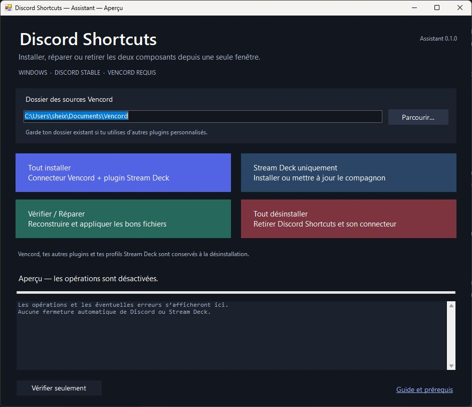

# Installer, mettre à jour ou désinstaller Discord Shortcuts

[← Accueil](../README.md) · [Télécharger l’assistant Windows](https://github.com/Sheixo/DiscordShortcuts/releases/download/v0.4.0/DiscordShortcuts-Assistant-Windows-0.1.0.zip)

**Une fenêtre pour installer, réparer et désinstaller.** Tu n’as pas de commandes PowerShell à recopier ni de fichiers compilés à déplacer toi-même. Le paquet contient l’assistant Windows 0.1.0, le connecteur 0.3.0 et le plugin Stream Deck 0.4.0.0.

Deux composants restent nécessaires : **ShortcutToggle dans Vencord** et **Discord Shortcuts dans Stream Deck**. L’assistant les gère ensemble ; Vencord reste nécessaire.

## Avant de commencer

- **Discord officiel Stable**, sous Windows 10 ou plus récent.
- **Stream Deck 7.1** ou plus récent, installé et ouvert au moins une fois.
- [Node.js 22 ou une version LTS plus récente](https://nodejs.org/), [Git pour Windows](https://git-scm.com/downloads/win) et [pnpm](https://pnpm.io/installation), installés et accessibles dans le PATH. Ces outils servent à compiler Vencord et restent nécessaires pour installer, réparer ou retirer uniquement le connecteur.
- Une connexion Internet pour les sources et les dépendances.

Si tu possèdes déjà les sources Vencord avec d’autres plugins personnalisés, garde ce dossier : l’assistant peut le réutiliser. Il ne remplace pas un dossier existant qui ne contient pas Vencord et ne met pas automatiquement ses sources à jour.

## Installer les deux composants

1. Télécharge [**DiscordShortcuts-Assistant-Windows-0.1.0.zip**](https://github.com/Sheixo/DiscordShortcuts/releases/download/v0.4.0/DiscordShortcuts-Assistant-Windows-0.1.0.zip), puis utilise **Extraire tout**. Garde ensemble tous les fichiers extraits.
2. **Quitte complètement Discord et Stream Deck depuis leurs icônes près de l’horloge.** Un éventuel appel vocal sera interrompu. L’assistant ne ferme aucune application automatiquement.
3. Dans le dossier extrait, double-clique sur **DiscordShortcuts-Assistant.exe**.
4. Le champ propose **Documents\Vencord**. Garde-le si c’est ton dossier, ou utilise **Parcourir** pour choisir les sources Vencord existantes. Si le dossier choisi n’existe pas, l’installation y télécharge les sources officielles.
5. Clique sur **Tout installer** et attends le message **Installation terminée**. L’assistant place le connecteur, prépare les dépendances, compile Vencord, applique les fichiers à la copie réellement chargée par Discord et installe le plugin Stream Deck. Les fichiers remplacés sont sauvegardés.
6. Relance Discord, puis active **ShortcutToggle** dans **Paramètres → Vencord → Plugins**.
7. Relance Stream Deck, puis ajoute l’action de la catégorie **Discord Shortcuts** à une touche. Son nom peut apparaître comme **Discord Keybinds** ou **Raccourcis Discord**, selon la langue. Sélectionne la touche : le panneau doit indiquer **Discord connecté** et afficher tes raccourcis.

Le nom à rechercher dans Discord est **ShortcutToggle**. Tous les réglages se trouvent ensuite dans Stream Deck.

L’assistant utilise le [processus officiel de compilation et d’installation de Vencord](https://docs.vencord.dev/installing/). Il ne demande aucun identifiant Discord et ne modifie pas les fichiers de session.

## Choisir le bon bouton

| Bouton | Quand l’utiliser |
| --- | --- |
| **Tout installer** | Première installation ou mise à jour des deux composants. |
| **Stream Deck uniquement** | Installer ou mettre à jour seulement le compagnon, sans modifier Vencord. Seul Stream Deck doit être fermé. |
| **Vérifier / Réparer** | Refaire la compilation et appliquer les fichiers du paquet aux bonnes copies de Discord et Stream Deck. Ferme les deux applications. |
| **Tout désinstaller** | Retirer nos deux composants, après confirmation. Ferme les deux applications. |
| **Vérifier seulement** | Comparer les fichiers sans modification. Les applications peuvent rester ouvertes. Ce contrôle ne prouve pas la connexion en cours. |

Si Node.js est absent, **Stream Deck uniquement** ouvre le fichier **fr.ethan.discord-shortcuts.streamDeckPlugin** fourni : termine l’installation dans Stream Deck. L’ouverture de cet installateur n’est pas encore une confirmation d’installation.

## Pour une prochaine mise à jour

**Télécharge le nouveau paquet, extrais-le, ferme les deux applications et clique sur Tout installer.** Choisis le même dossier Vencord. Tu n’as pas à déterminer toi-même où copier les fichiers ou quand relancer l’injection.

Le panneau recherche les nouvelles versions ; leur installation reste manuelle. **Vérifier / Réparer** réapplique la version contenue dans le paquet ouvert : télécharge le nouveau paquet pour obtenir une version plus récente.

## Désinstaller

1. Garde les sources Vencord et les outils de compilation disponibles.
2. Quitte complètement Discord et Stream Deck.
3. Ouvre l’assistant, choisis le dossier Vencord utilisé lors de l’installation et clique sur **Tout désinstaller**.
4. Lis la confirmation et valide si tu souhaites retirer Discord Shortcuts. Attends la fin avant de relancer les applications.

L’assistant retire **ShortcutToggle** des sources et de la compilation active, puis retire **Discord Shortcuts** de Stream Deck. Une nouvelle compilation de Vencord permet de conserver tes autres plugins.

**Sont conservés :** Vencord, les autres plugins personnalisés, les raccourcis et comptes Discord, les profils Stream Deck, Node.js, Git et pnpm. Les touches Discord Shortcuts déjà placées dans les profils peuvent rester visibles comme actions manquantes ; tu peux les retirer dans Stream Deck.

Les fichiers retirés sont conservés dans des sauvegardes : **.discord-shortcuts-backups** sous les sources Vencord et **%APPDATA%\Elgato\StreamDeck\DiscordShortcutsBackups** pour Stream Deck. L’assistant ne les efface pas automatiquement.

## Vérifier le fonctionnement

1. Mets **OFF** et essaie un raccourci Discord habituel : son action doit être suspendue.
2. Décoche ce raccourci dans Stream Deck : son action doit redevenir disponible, même sur OFF.
3. Recoche-le, puis remets **ON** : son action doit fonctionner à nouveau.

Les touches restent utilisables pour écrire et jouer. Configure les nouveaux raccourcis dans Discord : ils apparaissent automatiquement, cochés par défaut, dans Stream Deck. Le redémarrage de Discord remet ON ; une reconnexion de Stream Deck conserve l’état existant.

## Dépannage

- **L’assistant s’arrête :** lis la dernière ligne du journal. Une erreur de téléchargement ou de compilation doit être résolue avant de relancer la même action.
- **ShortcutToggle est absent :** utilise **Vérifier seulement**, puis **Vérifier / Réparer** après fermeture des applications. Ferme et relance complètement Discord, puis active le plugin dans Vencord.
- **Deux copies Vencord existent :** l’assistant vérifie la copie réellement chargée par Discord. Il applique les fichiers à cette copie si elle est reconnue ; sinon, il affiche le dossier et s’arrête. Choisis les sources correspondantes ou joins ce message à une [demande d’aide](https://github.com/Sheixo/DiscordShortcuts/issues).
- **Le panneau reste hors ligne :** vérifie que Discord est ouvert, que ShortcutToggle est activé et que l’action Discord Shortcuts est présente. Utilise **Actualiser la connexion** dans le panneau.
- **La désinstallation demande les sources :** elles sont nécessaires pour retirer le connecteur en conservant Vencord et les autres plugins. Choisis le dossier utilisé lors de l’installation.
- **Tu utilises l’ancien assistant en console :** il reste disponible dans les anciens téléchargements. Le nouvel assistant graphique remplace ce flux ; tu peux utiliser le même dossier Vencord.

Cette procédure vise **Discord Stable sous Windows**. Vesktop, Discord PTB/Canary, le navigateur, macOS et Linux ne sont pas pris en charge.

Pour le développement manuel : [guide officiel des plugins personnalisés Vencord](https://docs.vencord.dev/installing/custom-plugins/) et [développement du projet](DEVELOPPEMENT.fr.md).
